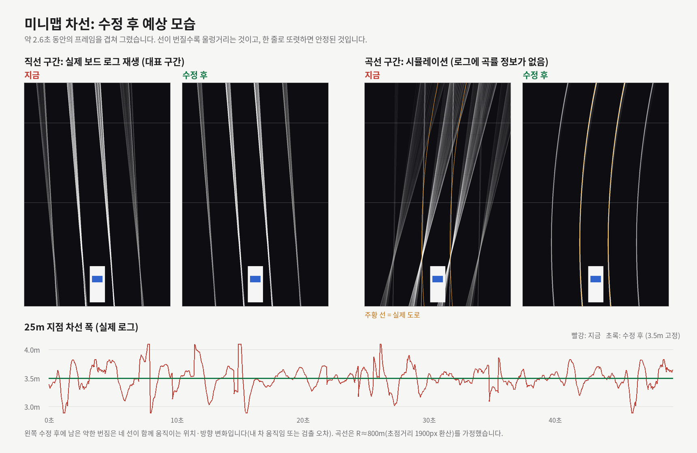
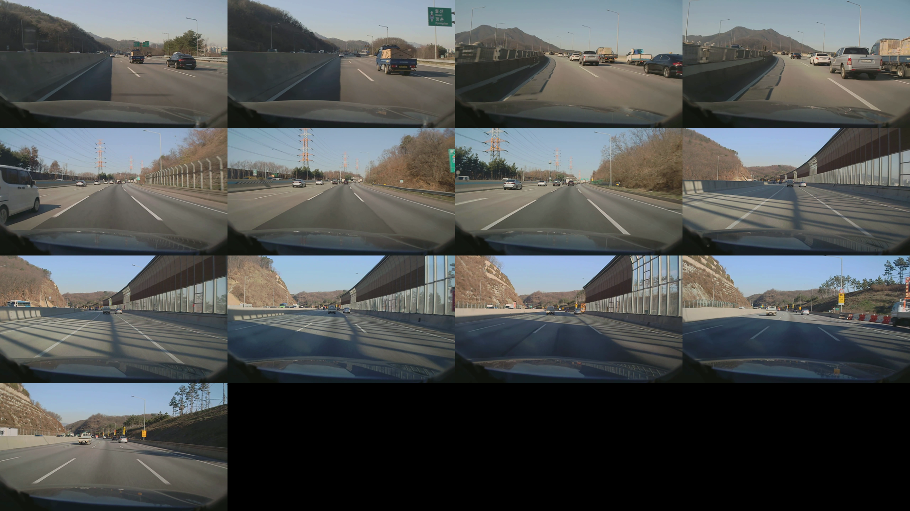
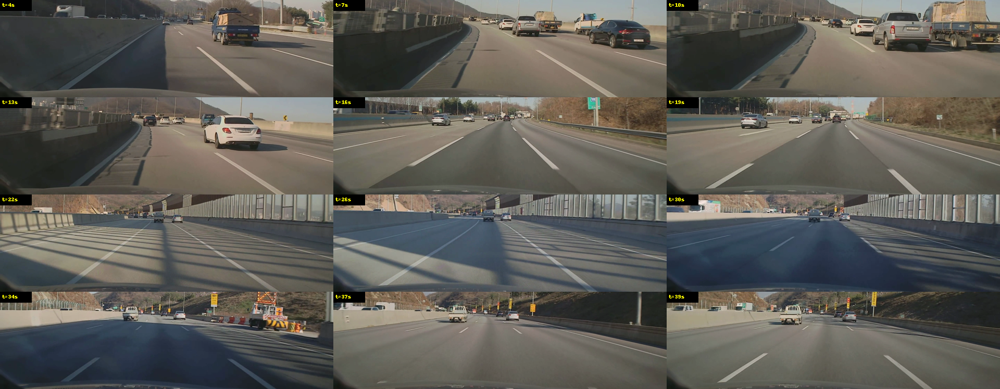
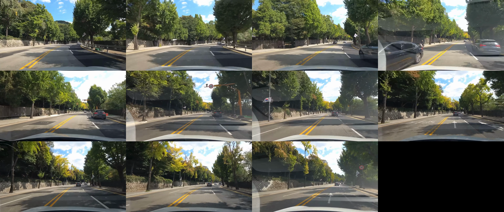
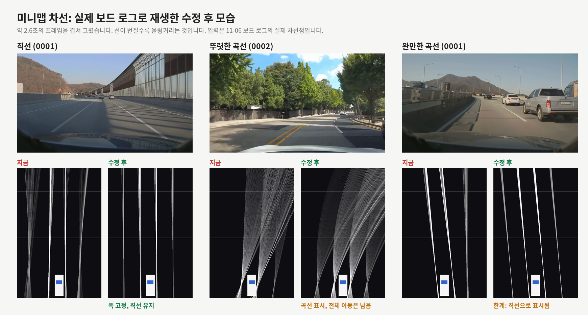

# 11-06 미니맵 차선 울렁임 수정 정리

2026-11-06 작업 기록 · 커밋 `14397e2` (`minimap-1105`, push 전)

미니맵 차선이 울렁거리는 문제를 분석하고 고친 과정을 순서대로 정리했다.
틀렸던 가정과 되돌린 판단도 그대로 남겼다.

## 요약

| 항목 | 0001 수정 전 | 0001 수정 후 | 0002 수정 전 | 0002 수정 후 |
| --- | --- | --- | --- | --- |
| 25m 차선 폭 (p5~p95) | 2.45~4.18m | 3.5m 고정 | 2.57~4.53m | 3.5m 고정 |
| 25m 위치 순간 튐 (p99) | 0.49m | 0.15m | 0.95m | 0.45m |
| 직선을 곡선으로 오판 | - | 0% | - | 2% |
| 뚜렷한 곡선을 곡선으로 표시 | - | 영상에 없음 | - | 100% |
| 완만한 곡선 | - | 직선으로 표시 (의도) | - | - |

- 수치는 보드 로그 기준이다. `0001`은 고속도로 영상, `0002`는 시내 도로 영상이다.
- 3.5m 폭은 측정값이 아니라 고정 간격으로 그린 결과다.
- 수정 전 수치는 `bevlog4`의 실제 차선점을 당시 코드와 같은 방식으로 PC에서 재계산한 값이고, 수정 후 수치는 `bevlog6` 보드 실행 결과다.
- 보드 화면에서 직접 본 확인은 이 문서의 수치에 포함되어 있지 않다.

## 1. 문제 제기

두 가지 문제가 있었다.

1. 미니맵의 차선이 울렁울렁거린다.
2. 트럭을 정확하게 인식하지 못한다(트럭과 차로 계속 번갈아 인식한다).

이번에 고친 것은 1번이다. 2번은 분석만 했다(9장).

## 2. 첫 원인 분석 (`bevlog3`)

코드를 읽고 기존 보드 로그를 분석했다. 코드는 수정하지 않았다.

**원인 ①: 지평선 값이 늦게 따라온다**

- 차선을 도로 좌표로 바꿀 때 현재 프레임 지평선이 아니라 EMA로 평활화한 지평선(`calib_vp_y`, ALPHA 0.10)을 썼다.
- 지평선 오차가 있으면 왼쪽과 오른쪽 차선이 서로 반대로 틀어져서 부채처럼 벌어졌다 오므라든다.

| 항목 | 값 |
| --- | --- |
| 현재 지평선과 평활화 지평선의 차이 | 약 ±3.6px (p90) |
| 25m 차선 폭 (로그의 직선 값으로 계산) | 3.13~3.81m |
| 20m 차선 폭과 지평선 오차의 상관계수 | -0.995 |
| 흔들림 한 주기 | 중앙값 약 1.3초 |

프레임 간 변화는 작아서(25m에서 p90 0.04m) 떨림이 아니라 느린 울렁임으로 보인다.

**원인 ②: 먼 구간의 차선점 부족 (추정)**

48.8m 지점의 점이 60m 제한을 넘나들어서 2차식이 불안정해진다고 추정했다. **이 가정은 나중에 틀린 것으로 드러났다(6장).**

**효과가 없다고 판단한 방법**

- 차선 좌표에 EMA만 추가: 프레임 변화 p90이 0.034m에서 0.031m로 줄 뿐이고 지연만 늘어난다.
- `ALPHA`를 더 낮추기: 지평선 오차가 오히려 커진다.

## 3. 수정 방향 제안과 첫 예상 그림

요구 조건은 세 가지였다. 폭은 항상 일정하고, 곡선은 곡선으로, 직선은 직선으로 보여야 한다.

**제안:** 왼쪽과 오른쪽을 따로 그리지 않고, 차선 중심선 하나를 구한 뒤 양쪽을 고정 간격으로 그린다.

```
중심선: x = c0 + h·z + c·z²
내 차선: 중심선 ±1.75m
옆 차선: 중심선 ±5.25m
```

이 PC에는 ffmpeg, numpy, matplotlib가 없어서 순수 파이썬으로 실제 로그 재생과 곡선 시뮬레이션을 만들었다. 시뮬레이션은 UFLD 양자화와 프레임 평균까지 넣었고, 현재 코드의 폭 흔들림(3.1~3.9m)을 실제 로그와 비슷하게 재현했다.



> ⚠️ **이 그림은 폐기했다.** 먼 차선점이 있다는 잘못된 가정으로 만든 시뮬레이션이라 낙관적이다. 기록용으로만 남긴다. 움직이는 비교는 `~/미니맵_차선_수정후_예상.gif`이고 역시 같은 이유로 쓰지 않는다.

**이 단계에서 새로 알게 된 것**

- **차량도 같이 바꿔야 한다.** 차선만 고치면 차량이 차선 안에서 약 0.26m(p90) 흔들린다.
- **곡률 제한이 너무 작다.** `MM_LANE_MAX_CURV 0.003`은 초점거리 1900px 기준으로 약 R 1300m라서, 이보다 급한 곡선은 직선으로 떨어진다.

### 3-1. 큰 튐 발견과 필터 추가

첫 그림의 폭 그래프에 계단식 튐이 보여서 확인했다.

- 지평선이 한 번에 20~30px씩 움직이는 튐이 있었고, 45초 주기로 같은 시각에 반복됐다.
- 현재 프레임 지평선만 쓰면 이 튐이 그대로 화면에 나온다(25m에서 최대 1.07m).
- 중심 위치와 방향에 가벼운 필터(EMA 0.35)를 넣으면 최대 0.37m로 줄어든다.

"현재 프레임 지평선만 쓰면 된다"는 처음 설명을 이 단계에서 정정했다.

## 4. 차선점 로그 추가

당시 로그에는 실제로 그리는 차선점이 없어서 곡선을 판단할 근거가 없었다. 그래서 본 수정 전에 로그부터 추가했다.

**고친 것**

- `bev_lanepts.csv`를 새로 만들었다. 새 차선 결과마다 차선 하나당 한 줄을 기록한다.
- 열은 `t_lane_us, ch, lane, lane_class, point_cnt, k_cal, vp_cal, pts`이고, `pts`는 `u:v;u:v;...` 형식이다.
- 기록 위치는 `nc_minimap.c`의 `mm_draw_lanes`다.

**판단 변경:** 처음에는 `bev_lane.csv`에 열을 추가하려고 했지만, 기존 분석 도구가 그 파일을 읽고 있어서 새 파일로 만들었다.

**결과:** 보드용 빌드 통과. 미니맵 화면 동작은 그대로다.

## 5. 보드 직접 접속 설정

로그를 직접 받을 수 있는지 확인했다.

- 보드 기본 IP `192.168.13.246`은 응답이 없었다.
- 이 VM이 NFS 서버(`/nfsroot`)이고 실제 보드는 `192.168.13.33`이었다. 보드에는 `/mnt/nfs`로 마운트되어 있다.
- 기존 `bevlog3`도 보드가 `/nfsroot`에 직접 쓴 것이었다.
- SSH 키를 등록해서 앱 업로드, 실행, 로그 수집을 VM에서 할 수 있게 됐다.

**보드 변경 사항**

- 기존 앱을 `app_wayland_npu.before_lanepts`로 백업했다.
- `0002` 영상은 보드에 없어서 `/nfsroot`에 복사해 `-i` 옵션으로 읽었다.
- 100초 실행에서 남은 로그 길이는 `bevlog4`가 약 60초, `bevlog5`와 `bevlog6`이 약 98초다. `bevlog4`가 짧은 이유는 확인하지 못했다.

## 6. 실제 차선점으로 확인한 결과 (`bevlog4`)

두 영상을 약 100초씩 돌려서 실제 차선점을 얻었다. 여기서 이전 분석이 크게 바뀌었다.

**먼 차선점은 없었다.**

- 자기 차선 점은 약 13m에서 끝난다. 48.8m 점은 실제 로그에 나오지 않았다.
- 미니맵의 13~25m 구간은 전부 연장해서 그린 선이다.
- 원인 ②의 가정은 틀렸다.

**실제 폭 흔들림은 계산보다 훨씬 컸다.**

| 항목 | 0001 | 0002 |
| --- | --- | --- |
| 25m 폭 (p5~p95) | 2.45~4.18m | 2.57~4.53m |
| 25m 폭 (최소~최대) | 0.15~4.43m | 2.1~8.53m |
| 곡률 제한에 걸려 직선으로 떨어지는 비율 | 58% | 86% |

2장에서 계산한 3.13~3.81m는 로그의 직선 값으로 구한 것이라, 실제 그려지는 2차식의 흔들림이 빠져 있었다. 2차식과 직선 사이를 계속 오가는 것이 지평선 지연에 더해 큰 원인으로 보인다.

## 7. 실제 영상과 대조: 곡선 기준 결정

곡률 추정값이 25m에서 ±3m로 크게 나와서, 진짜 곡선인지 확인이 필요했다. 보드의 ffmpeg로 영상 프레임을 뽑아 도로 모양과 비교했다.

**`0001`: 고속도로, 40초.** 약 7~14초 구간이 왼쪽 완만한 곡선이다(표지판과 벽의 휘어짐으로 판단).





**`0002`: 시내 도로, 15.8초.** 앞쪽 약 0~6초가 뚜렷한 오른쪽 곡선이다.



**곡률 추정 비교** (25m 지점 휨)

| 방식 | 0001 곡선 | 0001 직선 오차 (p95) | 0002 곡선 | 0002 직선 오차 (p95) |
| --- | --- | --- | --- | --- |
| 자기 차선만, 전체 점 | -2.7m | 3.1m | +7.4m | 2.4m |
| 자기 차선만, 보닛 아래 점 제외 | -3.6m | 3.1m | +8.5m | 2.9m |
| 차선 4개, 간격 자유 | -0.8m | 2.7m | +7.4m | 2.8m |
| 차선 4개, 간격 자유, 보닛 제외 | -2.0m | 2.6m | +8.2m | 3.1m |

- 방향은 실제 도로와 맞았다.
- 어떤 방식이든 직선에서 약 ±3m 오판이 남았다.
- `0002`의 곡선(+7m)은 구분되지만, `0001`의 완만한 곡선(약 -3m)은 오판과 크기가 같아서 구분되지 않는다.

**결정:** 곡선 기준을 25m에서 4.5m 휨으로 높이고, 완만한 곡선은 직선으로 그린다.
기준을 낮추면 곧은 도로가 휘어 보여서 울렁임이 다시 나타나기 때문이다. 완만한 곡선까지 정확히 그리려면 차량 속도나 조향각 같은 다른 정보가 필요하다.

수정안을 PC에서 실제 차선점으로 재생한 결과다.



가운데 `0002` 곡선은 폭은 일정하지만 네 선이 함께 좌우로 움직인다.

## 8. 본 수정

### 8-1. 1차 구현 (`bevlog5`)

**고친 것**

- `nc_ldw.c/h`: `stNcLdwGeom`에 `k_inst`, `vp_inst`, `left_ok`, `right_ok`를 추가했다.
- `nc_minimap.c`:
  - 좌우 차선점을 함께 써서 중심선 하나를 구한다. 차선은 고정 간격으로 그린다.
  - 곡률은 1초로 평활화하고, 25m 휨 4.5m 이상이면 곡선을 켜고 3.2m 아래면 끈다.
  - 중심 위치와 방향에 필터를 건다(시간 상수 0.09초, 26fps 기준 EMA 0.35).
  - 옆 차선은 네트워크가 검출할 때만 그린다(끊긴 뒤 1초까지 유지).
  - 차량 옆 위치를 차선과 같은 기하값으로 계산한다.
- `nc_bevlog.c/h`: `bev_lanefit.csv`를 추가했다(곡률, 곡선 상태 기록).

**결과** (보드 실행)

| 항목 | 0001 | 0002 |
| --- | --- | --- |
| 앱 동작 | 끝까지 정상 | 끝까지 정상 |
| C 코드와 파이썬 재현 차이 (25m, 중앙값) | 0.001m | 0.013m |
| 25m 위치 튐 (p99 / 최대) | 0.15m / 0.28m | 0.46m / 8.48m |
| 직선을 곡선으로 오판 | 0% | 11% |
| 뚜렷한 곡선 표시 | 해당 없음 | 100% |
| 차량과 차선 오차 (p90) | 0.32m | 4.67m |

두 값이 문제였다. 25m 위치가 한 번에 8.48m 튀고, `0002`의 차량 오차가 4.67m였다.

### 8-2. 원인 확인

- **8m 튐:** 18초마다, 즉 영상이 처음으로 돌아갈 때만 나왔다. 이때 지평선이 628에서 550으로 튄다.
- **기하값 전환:** `0002`는 왼쪽 차선이 한 프레임씩 끊기는 일이 881번 있었다. 그때마다 기하값이 현재 프레임 값과 평활화 값을 오갔다.

### 8-3. 2차 수정 (`bevlog6`, 최종)

**고친 것**

- 한쪽 차선이 끊기면 마지막 정상 기하값을 최대 1초 유지한다.
- 평활화 지평선과 30px 이상 차이 나는 프레임 값은 버린다.

**결과** (보드 실행)

| 항목 | 0001 1차 → 2차 | 0002 1차 → 2차 |
| --- | --- | --- |
| 25m 위치 튐 (p99) | 0.15m → 0.15m | 0.46m → 0.45m |
| 25m 위치 튐 (최대) | 0.28m → 0.35m | 8.48m → 8.61m |
| 직선을 곡선으로 오판 | 0% → 0% | 11% → 2% |
| 뚜렷한 곡선 표시 | 해당 없음 | 100% → 100% |
| 곡선 켜짐/꺼짐 횟수 | 0 → 0 | 10 → 11 |
| 차량과 차선 오차 (p90) | 0.32m → 0.32m | 4.67m → 4.58m |

- 직선 오판은 크게 줄었다. 곡선 켜짐/꺼짐은 영상 반복 횟수에 맞는 수준으로 깜빡임이 없다.
- 8m 튐은 남았다. 영상이 처음으로 돌아갈 때 장면 자체가 끊기는 시점이고, 0.15초 넘는 공백을 빼면 `0002`의 최대 튐은 0.95m다.
- 차량 오차는 거의 그대로여서 원인 추정이 맞지 않았다.

### 8-4. 차량 오차 재측정

차량 오차가 줄지 않아 측정 방법을 다시 봤다. 이 측정은 곧은 차선을 기준으로 삼기 때문에, 곡선이 켜진 프레임에서는 크게 나오는 게 당연했다.

| 구간 | 0001 | 0002 |
| --- | --- | --- |
| 곡선 꺼짐 (p50 / p90) | 0.12m / 0.32m | 0.14m / 0.39m |
| 곡선 켜짐 (p50 / p90) | 해당 없음 | 0.19m / 5.38m |

- 곡선 꺼짐 구간의 p90은 처음에 말한 약 0.05m보다 크고, 원인은 아직 확인하지 못했다.
- 곡선 켜짐 구간은 이 측정으로 판단할 수 없어서, 곡선에서 차량 위치는 검증하지 못한 상태다.

## 9. 트럭 인식 분석 (수정 안 함)

**원인**

- 거리에 따라 모델 판단이 달라진다. 가장 오래 추적된 트럭 추정 차량의 박스 높이별 결과다.

| 박스 높이 | car | tru |
| --- | --- | --- |
| 40px 미만 | 76 | 0 |
| 40~60px | 55 | 26 |
| 60~80px | 41 | 276 |
| 80px 이상 | 2 | 188 |

- 프레임마다 class를 새로 정하고 트래커도 class별로 따로 돌아서, 664프레임 동안 47번 바뀌었다.
- 미니맵 투표(`DECAY 0.8`, `SWITCH 1.0`)가 너무 짧아서 몇 프레임 만에 뒤집힌다.
- `nc_traj`가 (class, track_id)를 키로 쓰기 때문에 class가 바뀌면 칼만 이력이 끊긴다.

**원인이 아닌 것:** 같은 박스에 car와 tru가 동시에 뜨는 경우는 0건이었다. NMS나 임계값 조정으로는 해결되지 않는다.

**해결 후보**

1. 미니맵 투표를 `DECAY 0.97`, `SWITCH 3`으로 변경: 로그 재현에서 뒤집힘이 46번에서 5번으로 준다. 카메라 라벨은 그대로다.
2. car, bus, tru 통합 추적과 트랙별 class 투표: 근본 해결이다.
3. 트럭 데이터로 파인튜닝: 장기 과제다.

## 10. 틀렸던 판단 정리

| 처음 판단 | 실제 |
| --- | --- |
| 48.8m 먼 차선점이 있고 제한을 넘나든다 | 자기 차선 점은 약 13m에서 끝난다 |
| 25m 폭은 3.13~3.81m다 | 실제 차선점으로는 2.45~4.18m다 |
| 현재 프레임 지평선만 쓰면 된다 | 튀는 값이 있어 필터와 이상값 제거가 필요하다 |
| 곡선은 곡선으로 표시할 수 있다 (시뮬레이션) | 뚜렷한 곡선만 가능하고 완만한 곡선은 안 된다 |
| 차량 오차는 약 0.05m가 된다 | 곡선 꺼짐 구간 p90 0.32~0.39m다 |
| 차량 오차 4.6m는 기하값 전환 때문이다 | 곡선 구간을 곧은 기준으로 잰 측정 문제가 컸다 |

## 11. 현재 상태

- **커밋:** `14397e2 Minimap: constant-width lanes from one centre curve` (`minimap-1105`)
  - push와 `master` 병합은 아직 하지 않았다.
  - 수정 파일: `nc_ldw.c/h`, `nc_minimap.c/h`, `nc_bevlog.c/h`
- **보드:** 수정본 설치, 앱은 꺼진 상태다. 수정 전 앱은 `app_wayland_npu.before_lanepts`에 있다.
- **로그:** `/nfsroot/bevlog4_*` (수정 전), `bevlog5_*` (1차), `bevlog6_*` (최종)
- **영상:** `/nfsroot/1920_1080_0002.mp4`

## 12. 남은 일

- [ ] `nc_ldw.c/h` 변경을 준우에게 공유 (`stNcLdwGeom`에 필드 4개 추가)
- [ ] `minimap-1105` push와 `master` 병합
- [ ] 곡선 구간에서 차량이 차선 안에 제대로 놓이는지 확인
- [ ] 직선 구간 차량 오차(p90 0.32~0.39m) 원인 확인
- [ ] 다른 영상으로 곡선 기준값 재확인 (지금은 영상 두 개에 맞춘 값)
- [ ] 실제 주행 입력에서 큰 튐이 없는지 확인 (8m 튐은 영상 반복 시점에만 확인됨)
- [ ] 트럭 인식 수정 (9장)
